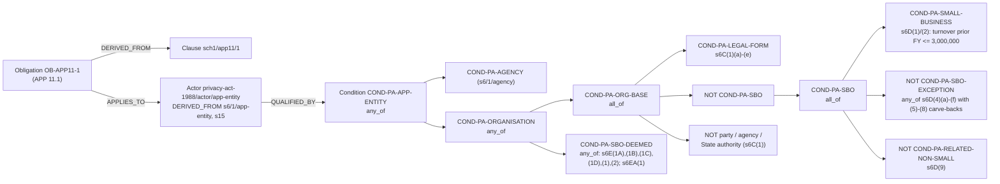

# Graph ontology: options for the Phase 2 design session (#93)

This document prepares the seven questions in #93. For each one it gives:
- the options, and what each makes easy or forecloses;
- the locked decision or `CONTEXT.md` entry it touches;
- a concrete case from the Privacy Act or the Acme fixtures;
- a recommendation.

Nothing here is decided. The recommendations are inputs to the session, and every ontology choice stays with the human.

The document is built around one worked question, because it settles most of the seven at once: **"Does the Privacy Act apply to us?"** It is traced for Acme at $2.5M and at $4M turnover. The small business exemption (ss 6C, 6D, 6DA, 6E, 6EA) is worked in full along the way.

## Sources, and three gaps found while preparing this

All statutory text is quoted verbatim from compilation **C2026C00227**. It was fetched on 2026-10-11 from the Register's unpacked ePub (`legislation.gov.au/C2004A03712/2026-06-04/2026-06-04/text/original/epub/OEBPS/document_1/document_1.html`, 2,359,908 bytes, the route in `legislation-gov-au-format.md`). Acme facts come from `docs/research/fixtures/synthetic-policies/`.

1. **s6D, s6DA, s6E and s6EA are not in the corpus.**
   - The golden-set excerpt stops after s6C.
   - The full compilation was never ingested: the corpus bucket holds only reranker artefacts.
   - The selection manifest lists `s6d/` and `s6e/`, but not `s6da/` (the turnover definition s6D depends on) or `s6ea/` (opt-in).
   - So the hardest real case in Phase 1 can't be cited by the verifier today.
2. **The parser fails on the full compilation.** `parse_compilation` raises `invalid clause_path: 's1/'` at section 1. It has only ever been run on the excerpt.
3. **The profile can't express what s6D asks.**
   - `Profile` has `size_band` and no turnover. It records nothing about turnover history, health services, trading in personal information, Commonwealth contracts or related bodies corporate.
   - It also has no time dimension, while the turnover test is defined per financial year relative to the test time.

Gaps 1 and 2 are follow-up tickets that need no decision (see the end). Gap 3 is part of question 2.

---

## The worked question: "Does the Privacy Act apply to us?"

### What the law actually says

The obligations are the APPs, and s15 binds them to APP entities:

> **s15** An APP entity must not do an act, or engage in a practice, that breaches an Australian Privacy Principle.

> **s6(1)** APP entity means an agency or organisation.

> **s6C(1)** organisation means: (a) an individual; or (b) a body corporate; or (c) a partnership; or (d) any other unincorporated association; or (e) a trust; that is not a small business operator, a registered political party, an agency, a State or Territory authority or a prescribed instrumentality of a State or Territory.

> **s6D(1)** A business is a small business at a time (the test time) in a financial year (the current year) if its annual turnover for the previous financial year is $3,000,000 or less.
>
> **s6D(2)** However, if there was no time in the previous financial year when the business was carried on, the business is a small business at the test time only if its annual turnover for the current year is $3,000,000 or less.
>
> **s6D(3)** A small business operator is an individual, body corporate, partnership, unincorporated association or trust that: (a) carries on one or more small businesses; and (b) does not carry on a business that is not a small business.
>
> **s6D(4)** However, an individual, body corporate, partnership, unincorporated association or trust is not a small business operator if he, she or it: (a) carries on a business that has had an annual turnover of more than $3,000,000 for a financial year that has ended after the later of the following: (i) the time he, she or it started to carry on the business; (ii) the commencement of this section; or (b) provides a health service to another individual and holds any health information except in an employee record; or (c) discloses personal information about another individual to anyone else for a benefit, service or advantage; or (d) provides a benefit, service or advantage to collect personal information about another individual from anyone else; or (e) is a contracted service provider for a Commonwealth contract (whether or not a party to the contract); or (f) is a credit reporting body.
>
> **s6D(5)–(8)** carve back (4)(b)–(d):
> - (5): an individual acting in their personal, family or household affairs, outside a business they carry on;
> - (6): any other entity acting outside the course of a business it carries on;
> - (7): for (4)(c), disclosure "with the consent of the other individual" or "as required or authorised by or under legislation";
> - (8): for (4)(d), the same two grounds, applied to the collection.
>
> **s6D(9)** Despite subsection (3), a body corporate is not a small business operator if it is related to a body corporate that carries on a business that is not a small business.

> **s6DA(1)** The annual turnover of a business for a financial year is the total of the following that is earned in the year in the course of the business: (a) the proceeds of sales of goods and/or services; (b) commission income; (c) repair and service income; (d) rent, leasing and hiring income; (e) government bounties and subsidies; (f) interest, royalties and dividends; (g) other operating income.

> **s6E** brings a small business operator back in "as if the small business operator were an organisation" in six cases:
> - (1A): it is an AML/CTF reporting entity, for those activities;
> - (1B): it is a Fair Work protected action ballot agent, for the ballot;
> - (1C): it is a registered employee association;
> - (1D): it holds consumer data right accreditation, for non-CDR personal information;
> - (1) and (2): it is prescribed by regulation, as a whole or for particular acts or practices.

> **s6EA(1)** This Act applies in relation to a small business operator as if the operator were an organisation while a choice by the operator to be treated as an organisation is registered under this section.

Three features of this text drive the modelling:

- **The exemption is a nested rule, not a threshold.** "Turnover over $3M" is one leaf of six exceptions, four carve-backs, one group rule and six deeming provisions. A single `turnover > 3000000` condition on each APP obligation, as the README's `COND-SMALL-BUSINESS-THRESHOLD` example suggests, would get it wrong.
- **It is history-dependent.** s6D(4)(a) means a business that has *ever* had a financial year over $3M (ended after it started) is never again a small business operator. Acme at $2.5M this year is still covered if it turned over $3.2M in 2023–24. "Current turnover" is not the fact s6D asks for.
- **It is time-relative.** s6D(1) reads the *previous* financial year relative to the test time. On `as_of` 2026-10-11 (FY 2026–27, Australian Jul–Jun), the fact needed is FY 2025–26 turnover.

### The recommended model, in one picture

*(An example only: the node IDs and the edge types `QUALIFIED_BY`, `ALL_OF`, `ANY_OF`, `NOT` and `DERIVED_FROM` are proposals for the session, not schema.)*

**The key move:** applicability is a property of an **Actor** (a role the law defines), not of each obligation. All ~60 APP sub-clause obligations `APPLIES_TO` the one Actor `app-entity`. Its qualification, the condition tree, is authored once and cited by its own clauses.

### Trace 1: Acme at $4M turnover (FY 2025–26), `as_of` 2026-10-11

**Profile facts needed (as dated evidence; see question 2):**
- `legal_form = body_corporate`, asserted (Acme Pty Ltd).
- `annual_turnover_aud[FY2025-26] = 4,000,000`, asserted.

**Track A, step by step:**

1. **Start from the instrument.** Query `GraphQuery(as_of=2026-10-11, max_depth=…)` from `Instrument privacy-act-1988`. It follows `VERSION_OF` (inbound) to `InstrumentVersion privacy-act-1988:C2026C00227` (in force from 2026-06-04), then `PART_OF` (inbound) to the clauses in force. This establishes which compilation's text answers for this date.
2. **Collect the obligations.** Every `Obligation` with `instrument_id = privacy-act-1988` in force on `as_of`: `OB-APP1-2`, `OB-APP11-1`, `OB-APP11-2`, and so on. Each is `DERIVED_FROM` its clause, and the path check ensures that clause is in force too.
3. **Find the role and its rule.** From each obligation, `APPLIES_TO` reaches `Actor privacy-act-1988/actor/app-entity`, which is `QUALIFIED_BY` reaches `COND-PA-APP-ENTITY`. The condition tree is then expanded through `ANY_OF`/`ALL_OF`/`NOT` edges.
4. **Evaluate the tree deterministically against the profile.** This is Python, not Cypher and not an LLM:
   - `COND-PA-SMALL-BUSINESS`: FY2025–26 turnover 4,000,000 is not ≤ 3,000,000, so **false** (s6D(1)).
   - So `COND-PA-SBO` (`all_of`) is **false**, whatever the exceptions are. The evaluator short-circuits: `s6D(4)(a)` and the rest need not be known.
   - `NOT COND-PA-SBO` is **true**. `COND-PA-LEGAL-FORM` is **true** (body corporate, s6C(1)(b)). `NOT party/agency/authority` is **true**. So `COND-PA-ORG-BASE` is **true**.
   - So `COND-PA-ORGANISATION` and then `COND-PA-APP-ENTITY` are **true**.
5. **Result.** Every APP obligation is **applicable**, with provenance `asserted` (two profile facts).

**The answer:**

> Yes. The APPs bind APP entities (s15). Acme is an organisation (s6C(1)(b)), not a small business operator, because its annual turnover for the previous financial year exceeded $3,000,000 (s6D(1)).

Each cited clause (`s15`, `s6/1/app-entity`, `s6c/1`, `s6c/1/b`, `s6d/1`) is verbatim and verifiable. These are exactly the condition nodes' `DERIVED_FROM` clauses: the reasoning *is* the citation set.

### Trace 2: Acme at $2.5M turnover (FY 2025–26), `as_of` 2026-10-11

**Profile facts:** `legal_form = body_corporate`, and `annual_turnover_aud[FY2025-26] = 2,500,000`. Nothing else.

1. Steps 1–3 are the same as Trace 1.
2. `COND-PA-SMALL-BUSINESS` is **true** (s6D(1)).
3. `COND-PA-SBO-EXCEPTION`, an `any_of` over s6D(4)(a)–(f):
   - **(a) turnover over $3M in any ended FY since it started:** *unknown*. The profile has one year, not the history.
   - **(b) provides a health service *and* holds health information other than in an employee record:**
     - *Documents inform:* D3 (employee data handling) §1.1 collects employee information "for payroll, superannuation, work health and safety, and performance management purposes". If that includes health information, it sits in **employee records**, which (b) expressly excludes.
     - *Not in the documents:* whether Acme provides a health service.
     - *Status:* still *unknown* as a fact, because documents inform and humans assert (CONTEXT: Evidence). D3 yields an `inferred` claim, not evidence.
   - **(c) discloses personal information for a benefit, service or advantage:**
     - D1 §3.3 discloses to "logistics partners, our payment provider, and our IT service providers, solely to the extent necessary for them to provide services to us". Whether that is "for a benefit" is a legal judgement the system must not make.
     - *Status:* *unknown*.
   - **(d) provides a benefit to collect personal information:** *unknown*.
   - **(e) Commonwealth contracted service provider:** *unknown*.
   - **(f) credit reporting body:** *unknown*.
   - **Result:** `any_of` with no true leaf and several unknowns is **unknown**.
4. So `COND-PA-SBO` (`all_of`: true, NOT unknown, NOT unknown for s6D(9)) is **unknown**. Then `COND-PA-ORG-BASE`, `COND-PA-ORGANISATION` (the `COND-PA-SBO-DEEMED` leaves are also unknown) and `COND-PA-APP-ENTITY` are all **unknown**.
5. **Result.** Every APP obligation is **unassessable**. The reason is not "missing data" but a list:

| Unknown leaf | Clause | Profile fact that would settle it |
|---|---|---|
| Turnover over $3M in any ended FY since it started | `s6d/4/a` | `annual_turnover_aud` per FY since the business started, or a confirmed "never over $3M" |
| Health service | `s6d/4/b` | `provides_health_service`, and `holds_health_info_outside_employee_records` (D3 points only to employee records) |
| Personal information disclosed for a benefit | `s6d/4/c`, carve-back `s6d/7` | `discloses_pi_for_benefit` (D1 §3.3 suggests service providers only) |
| Benefit provided to collect personal information | `s6d/4/d`, carve-back `s6d/8` | `pays_to_collect_pi` |
| Commonwealth contracted service provider | `s6d/4/e` | `commonwealth_contracted_service_provider` |
| Credit reporting body | `s6d/4/f` | `credit_reporting_body` |
| Related to a body corporate whose business is not small | `s6d/9` | `related_body_corporate_not_small` |
| Opted in under s6EA | `s6ea/1` | `opted_in_s6ea` (checkable against the Commissioner's public register, s6EA(6)) |
| Deemed an organisation under s6E | `s6e/1a`–`s6e/2` | `aml_ctf_reporting_entity`, `cdr_accredited`, and the rest |

**The answer:**

> Possibly. Acme's turnover puts it under the small-business threshold (s6D(1)), but whether it is a small business operator depends on nine facts the profile doesn't hold.

The coverage report lists each one with its clause, and each becomes a questionnaire question (see the unassessable path below).

If the human answers every question with "no", the tree evaluates **false**: Acme is a small business operator, and the APPs **do not apply**. That is a third outcome, *not applicable*, distinct from unassessable. The coverage report should show it with its reason (s6D(1) and s6D(3)), because "the Privacy Act doesn't apply to you" is the most consequential answer the system can give, and it must be just as cited.

### Which of the seven questions this settles

- **Q1, condition valid time:** conditions carry their own valid time, from the clauses they're derived from. If Parliament repeals the exemption (the tranche-2 proposal), `COND-PA-SBO` gets `valid_to` on commencement. A query `as_of` before that still finds Acme exempt; one after finds it bound. Undated conditions would make that impossible.
- **Q2, APPLIES_TO targets:** applicability attaches to an Actor defined by the law, qualified by a condition tree. The profile supplies dated facts, not self-declared roles.
- **Q6, obligation to clause:** the citation set is the set of clause nodes on the evaluated path. That only works if the links are edges the builder can check `as_of`, not properties.
- **The unassessable path** falls out of three-valued evaluation.

---

## Q1: Condition valid time

The README gives conditions no dates, but D-05 makes every node bitemporal.

| Option | Makes easy | Forecloses |
|---|---|---|
| **(a) A condition has its own valid time, sourced from its clauses** (`source_clause_ids`, `valid_from`, `valid_to`, like an obligation) | Repealing or amending a gate, such as s6D's $3M, is one retirement, and `as_of` answers both sides of the change. The loader checks the clauses are in force across the interval, exactly as for obligations | Nothing material. More YAML per condition |
| (b) Inherit valid time from the obligations that require it | No dates to author | A shared condition (the s6D tree gates ~60 obligations) gets whichever dates its users have. A threshold change can't be dated independently of the APPs |
| (c) Undated rules, an explicit exception to D-05 | Simplest YAML | `as_of` can't see a change to the gate itself. "Was Acme bound on 1 March?" gets answered with today's rule |

- **Touches:** D-05 (every node bitemporal), CONTEXT **Condition** and **Bitemporal**.
- **Example:** the s6D(4)(a) phrase "the commencement of this section" is itself a date, so the exemption has a start. A removal of the exemption, if enacted, would need an end.
- **Recommendation: (a).** It's the only option where the most likely real-world change to this corpus (exemption reform) is a single, dated, auditable retirement.

## Q2: APPLIES_TO targets (Actor, Jurisdiction, Sector)

| Option | Makes easy | Forecloses |
|---|---|---|
| **(a) Actor = a role defined by an instrument**, with stable ID `{instrument_id}/actor/{slug}`, `DERIVED_FROM` its defining clauses and `QUALIFIED_BY` a condition tree. Jurisdiction and Sector are reference nodes (ISO 3166-2 codes such as `AU`, `AU-NSW`; ANZSIC divisions such as `G` for retail trade), with long-lived valid time | One qualification per role, cited and dated. The answer explains *why* the tenant holds the role. Track A stays complete and deterministic (D-03) | Needs a small condition evaluator (Python) and composite condition edges (a schema change, so an ADR) |
| (b) Roles as self-declared profile tags (today's `actor_roles: [apn_entity]`) | Trivial traversal | The user decides the legal question ("am I an APP entity?") with no reasons and no citations. Provenance is `asserted` for a conclusion of law. Contradicts D-06's "unassessable (why)" |
| (c) No Actor: each obligation `REQUIRES` the full condition tree | No new node kind | The s6D tree copied onto ~60 obligations, or shared via REQUIRES to one root. That second variant is just (a) without a name |

- **Touches:** D-01 (hand-curated), D-03, D-06, CONTEXT **Profile**, **Condition**, **Evidence**, **Tenant subgraph** (`ACTS_AS` becomes a *result* of evaluation, projected per request, never stored).
- **Profile consequence (gap 3):** profile facts become **dated evidence**:
  - **Shape:** `(field, value, period, provenance, source)`, for example `annual_turnover_aud, 2500000, FY2025-26, asserted, "CFO, questionnaire 2026-10-11"`.
  - **Where:** the ledger.
  - **Why dated:** `as_of` evaluation reads the period the rule asks for (s6D(1)'s previous financial year).
- **Recommendation: (a).** The worked example shows why. The exemption's legal meaning lives in its structure, so a tag can't carry it.

## Q3: Controls

| Option | Makes easy | Forecloses |
|---|---|---|
| **(a) Controls are clauses of a standard** (ISO 27001:2022 Annex A from #12, as `Clause` plus a `Control` node per control with our own descriptors), dated by the standard's version. Obligations `CROSSWALKS_TO` controls; only an instrument that *mandates* controls uses `REQUIRES` | The same versioning, citation and as_of machinery as law. ISO 27001:2013 to 2022 is a supersession | Needs #12's control list (the human) and the licensing constraint: our descriptors, not ISO text |
| (b) Controls as free-floating nodes, undated | Quick | Breaks D-05, and "which control set applied on date X" becomes unanswerable |

- **Touches:** D-05, CONTEXT **Crosswalk**, the README's crosswalk example (`OB-APP11-1 → iso-27001:2022:annexa/8/3`, `kind: partial`).
- **Example:** APP 11.3 ("such steps include technical and organisational measures") is the Privacy Act's nearest point to a control framework, but it *requires* steps, not a named control. So it's a `partial` crosswalk, never `REQUIRES`.
- **Recommendation: (a).** `REQUIRES Control` is kept for future frameworks that do mandate controls.

## Q4: Corrections versus immutability

The README says "correcting a mapping edits the existing entry". D-05 makes a loaded node immutable, and today's loader refuses such an edit before any write.

| Option | Makes easy | Forecloses |
|---|---|---|
| (a) Every correction is a new id plus `supersedes` | One rule, perfect graph history | Ids multiply for typos. A mis-mapped `clause_id` and a typo in `summary` look the same |
| **(b) Split by meaning.** Anything that changes *what applies* (`clause_id`, dates, `applies_to`, `requires`, condition operator or value) supersedes with a new id. Cosmetic text (`summary`, crosswalk `note`) may be corrected in place through an explicit, audited path, as replace-in-place does for typos (ADR-0021) | Typos stay cheap. Meaning changes stay dated and visible | Needs the loader to know which fields are cosmetic (a closed list) and an audit record |
| (c) Rebuild the graph from git on every mapping change | No mutation question at all | Loses the immutability audit inside the graph, and Aura's write volume grows |

- **Touches:** D-05, CONTEXT **Mapping version** (an assessment records the mapping git tag, so it is reproducible from git whatever the graph holds), README *Stable IDs*.
- **Example:** `OB-APP11-1`'s summary misspelt is cosmetic. Pointing it at `sch1/app11/2` instead of `sch1/app11/1` changes meaning.
- **Recommendation: (b).** D-05's rationale ("deleting superseded law silently changes issued reports") is about meaning, and the mapping version already makes issued assessments reproducible.

## Q5: Policy mappings at request time

A policy-to-law mapping is tenant content, so it never enters Aura (D-09; CONTEXT **Policy**, **Tenant subgraph**).

| Option | Makes easy | Forecloses |
|---|---|---|
| **(a) Ledger table** (`policy_mapping`: tenant, policy clause id, obligation id, kind, status, proposer, approver, dates, `trace_id`), projected into the per-request tenant subgraph when `status = approved` | One residency story with the rest of tenant data. The approval queue is a ledger query. Purge and withdraw follow ADR-0021 | Needs a migration and an approval UI (Phase 3) |
| (b) Per-tenant YAML in git | Reuses the loader | Puts customer content in the repo, which is impossible for real tenants |
| (c) Qdrant payload | Co-located with chunks | Mixes a human judgement into a probabilistic store and breaks D-03's separation |

- **Touches:** D-01 (the LLM may propose, a human approves), D-09, D-14, ADR-0021, CONTEXT **Tenant subgraph**.
- **Example:** D2 §2's retention rule mapped to APP 11.2 (`sch1/app11/2`, destroy or de-identify) is proposed, shown in the queue, approved, and only then projected.
- **Recommendation: (a).**

## Q6: Obligation → Clause, property or edge

| Option | Makes easy | Forecloses |
|---|---|---|
| (a) Property `clause_id` (today) | Simple | A new compilation forces a new obligation even when the law didn't change (the clause stable ID changes with `version_id`). The builder can't check the clause is in force on the path |
| **(b) Edge `DERIVED_FROM` (Obligation→Clause, and Condition/Actor→Clause), one per compilation the obligation is grounded in** | The obligation survives a recompilation: add a `DERIVED_FROM` to the new clause, and the old clause retires with its version. The path check returns *the clause text in force on `as_of`*, which is exactly what the citation needs | New edge type in the schema (an ADR) |

- **Touches:** CONTEXT **Obligation** ("survives a new instrument version via SUPERSEDES, where the clause's stable ID does not"), D-05, the schema.
- **Example:** C2026C00227 is one of many compilations. APP 11.1's words haven't changed in years, yet every compilation mints `privacy-act-1988:{new id}:sch1/app11/1`. Under (a) that means re-authoring `OB-APP11-1`; under (b) it means adding one edge.
- **Recommendation: (b).** It also means CONTEXT's "SUPERSEDES" wording for obligations is needed only when the *obligation* changes, not the compilation.

## Q7: Status versus dates

| Option | Makes easy | Forecloses |
|---|---|---|
| (a) Status stored and validated against the dates | Keeps today's schema | Two representations of one fact that can disagree. "Repealed" with an open `valid_to` must be refused |
| **(b) Status derived at query time** (`not_yet_commenced` if `as_of < valid_from`; out of force if `as_of ≥ valid_to`; otherwise `in_force`), storing an `end_reason` instead (`superseded` / `repealed` / `expired`) | One source of truth. Loading a passed-but-not-commenced provision ahead of time just works | A D-05 wording change (it lists three statuses), so an ADR |

- **Touches:** D-05, CONTEXT **Bitemporal**, the schema's `status` existence constraints.
- **Example:** APP 11.3 ("technical and organisational measures") was inserted by the 2024 amending Act. Loaded with its commencement date as `valid_from`, an `as_of` before that date sees it as not yet commenced, with no stored status to keep in step. *The exact commencement date is to be confirmed from the compilation's endnotes before loading.*
- **Recommendation: (b).**

---

## Where an unassessable condition ends up (D-06)

1. **Evaluation is three-valued** (Kleene logic):
   - `all_of` is false if any child is false, otherwise unknown if any is unknown;
   - `any_of` is true if any child is true, otherwise unknown if any is unknown;
   - `not` swaps true and false and leaves unknown.

   A leaf is unknown when the profile has no evidence for its field *for the period the rule asks for*. Short-circuiting matters: in Trace 1, s6D(4) never needed asking.
2. **The result per obligation is one of three:** `applicable`, `not_applicable` or `unassessable`. Each carries its reasons, the leaves that decided it. Each reason holds the condition id, its clause ids, the profile field and period, and the condition's `unassessable_reason` text from YAML.
3. **Persisted:** a `coverage` row per assessment and obligation in the ledger, with the assessment's `trace_id`, mapping version and corpus version. This is what the Phase 2 exit criterion "coverage report lists every unassessable obligation with its reason" reads.
4. **Track B (D-03)** filters retrieval to `applicable` **and** `unassessable` obligation ids. So "possibly" answers still cite the law that would apply, and `not_applicable` ones are excluded (but reported).
5. **The answer** names unassessable obligations as such ("Possibly: depends on …"), never as compliant or non-compliant.
6. **Questionnaire:** each unknown leaf's field is a question. An answer creates **evidence** (`asserted`). A document can propose a **claim** (`inferred`, for example D1 §3.3 suggesting service-provider-only disclosure) that the user confirms into evidence. Then the assessment re-runs. Documents inform; humans assert (CONTEXT).

## Follow-ups that need neither the human nor the model

- **Parser on the full compilation:** fix the `s1/` failure, with a test over the whole C2026C00227.
- **Selection manifest:** `s6da/` and `s6ea/` are needed by this model but absent. The manifest is a reviewed human artefact, so adding them is proposed in a PR for the human's review, not merged on my own judgement.
- **Ingest the selected compilation into Cloud Storage** (the approved corpus bucket; no new resource), so s6D/s6E clauses exist for the verifier and the graph.

Each is filed as an issue.
